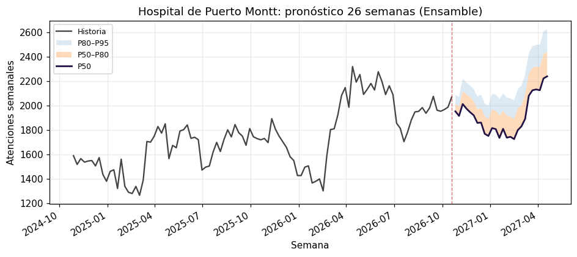

# urg-forecast-core

[](https://github.com/nicoveraz/urg-forecast-core/actions/workflows/ci.yml)
[](https://pypi.org/project/urg-forecast-core/)
[](https://pypi.org/project/urg-forecast-core/)
[](https://github.com/nicoveraz/urg-forecast-core/blob/main/LICENSE)
[](https://doi.org/10.5281/zenodo.21449610)

*[Documentación](https://nicoveraz.github.io/urg-forecast-core/) ·
[English](https://github.com/nicoveraz/urg-forecast-core/blob/main/README.en.md)*

<!-- sitio:inicio -->
**Una base abierta y gratuita para analizar y pronosticar la demanda de los servicios de
urgencia en Chile con datos públicos del DEIS MINSAL.** Con un solo comando
obtienes la descripción de la demanda, o un backtest y un pronóstico semanal, para
cualquier establecimiento de la red pública que reporte al DEIS. Es una aproximación inicial: ajustarla a tu
realidad es trabajo tuyo, y el código está hecho para eso.

**[Prueba la demo](https://nicoveraz.github.io/urg-forecast-core/demo/)**: elige
un establecimiento en el navegador y mira su pronóstico, sin instalar nada.

> **Es una base, no una herramienta de decisión.** Los modelos son estadísticos
> y simples, sin ajuste local, sobre datos públicos y agregados. Usa los
> resultados para explorar y para comparar tu propio trabajo, no para dotar un
> turno ni planificar un presupuesto sin validación local. Ver
> [Una base, no un producto](#una-base-no-un-producto).


## Inicio rápido

```bash
pip install urg-forecast-core                          # Python 3.11 o 3.12

urg-forecast demo                                      # hospitales de Puerto Montt y Frutillar
urg-forecast buscar "osorno"                           # busca por nombre, comuna, región o tipo
urg-forecast analizar 24-105                           # nivel, año típico, comparación interanual
urg-forecast pronosticar 24-105                        # backtest + pronóstico a 26 semanas
urg-forecast pronosticar 24-105 -H 6m                  # elige el horizonte: 12, 12s (semanas) o 6m (meses)
urg-forecast modelos                                   # lista los modelos disponibles
urg-forecast pronosticar 24-105 -m AutoARIMA           # usa un modelo en vez de comparar
urg-forecast pronosticar 24-105 -m Ensamble -m TBATS   # prueba modelos extra
urg-forecast pronosticar 24-105 -m mi_modulo:MiModelo  # o un modelo propio
```

Cada ejecución imprime un resumen con tablas ASCII y guarda CSV y figuras en
`./urg-forecast-salida/<código>_<nombre>/` (cámbialo con `-o`):

| Archivo | Contenido |
|---|---|
| `resumen.txt` | el resumen impreso |
| `pronostico.csv` | pronóstico semanal: `q50`, `q80`, `q90`, `q95` |
| `backtest.csv` | error de cada modelo en la ventana de backtest |
| `historia_semanal.csv` | la serie semanal que se modeló |
| `pronostico.png`, `backtest.png` | figuras |

Usa `urg-forecast -h`, o `urg-forecast <comando> -h`, para ver todas las
opciones con ejemplos. El detalle está en la
[referencia de comandos](#referencia-de-comandos).

Ejemplo de salida de `urg-forecast demo` con datos DEIS en vivo, el 5 de octubre de 2026:

```text
Hospital de Puerto Montt (24-105)
=================================

Datos      DEIS MINSAL (descarga actualizada); atenciones totales por semana
Historia   2022-01-10 a 2026-09-14 (245 semanas completas; 2020–2021 excluidos)
Horizonte  26 semanas

Backtest: 3 ventanas de 26 semanas, promedio (el modelo elegido se marca con *)
+---------------+-------+----------+---------------+
| Modelo        |   MAE |   MAPE % |   Pérdida P80 |
|---------------+-------+----------+---------------|
| Armónico *    |   207 |     10.7 |          91.0 |
| MSTL          |   231 |     11.9 |          91.6 |
| AutoARIMA     |   232 |     11.7 |         104.0 |
| SeasonalNaive |   359 |     17.6 |         230.0 |
+---------------+-------+----------+---------------+
Con Armónico, el valor real quedó bajo el P80 en 24 de 78 semanas.
Intervalos del pronóstico ensanchados según ese error: P80 x2.8, P90 x2.6, P95 x2.1.

Pronóstico con Armónico: atenciones semanales
+--------------------+-------+-------+-------+
| Semana (termina)   |   P50 |   P80 |   P95 |
|--------------------+-------+-------+-------|
| 2026-09-21         |  2042 |  2259 |  2350 |
| 2026-09-28         |  2027 |  2284 |  2393 |
| ...                |       |       |       |
```



<!-- sitio:uso -->
## Referencia de comandos

| Comando | Qué hace |
|---|---|
| `urg-forecast demo` | Pronóstico para el Hospital de Puerto Montt (24-105) y el Hospital de Frutillar (24-115). Si no hay red, usa el snapshot incluido. |
| `urg-forecast buscar [TEXTO]` | Lista los establecimientos cuyo nombre, código, tipo (Hospital, SAPU, SAR, SUR), comuna, región o servicio de salud contiene `TEXTO` (todos si va vacío). La primera columna es el código que recibe `pronosticar`. |
| `urg-forecast analizar CODIGO [CODIGO ...]` | Describe la demanda: nivel y su cambio en el último año, el año típico (semanas más altas y más bajas frente al nivel de su año), las últimas semanas frente a las mismas del año anterior, un resumen por año y el día de la semana. Escribe `analisis.txt`, `analisis.png` y las tablas en CSV. |
| `urg-forecast pronosticar CODIGO [CODIGO ...]` | Backtest + pronóstico para uno o más establecimientos. Códigos como `24-105` o `124105`. |
| `urg-forecast modelos` | Lista los modelos disponibles y cuáles se comparan por defecto. |
| `urg-forecast comparar CODIGO -m MODELO` | ¿Sirve un regresor o un modelo nuevo? Lo compara contra el Armónico (o `--base`) en muchas ventanas y dice si la diferencia es consistente o ruido. Ver [Agregar un regresor externo](#agregar-un-regresor-externo). |

| Opción | Comandos | Significado |
|---|---|---|
| `-H`, `--horizonte` | demo, pronosticar | Horizonte: semanas (`12`, `12s`) o meses (`6m`). Por defecto 26 semanas. |
| `-o`, `--salida` | demo, analizar, pronosticar | Carpeta de salida (por defecto `./urg-forecast-salida`); una subcarpeta por establecimiento. |
| `-m`, `--modelo` | demo, pronosticar | Modelo a usar, repetible. Nombre de `urg-forecast modelos` o `archivo:Clase` para uno propio. Ver [Modelos](#modelos). |
| `--base`, `--ventanas`, `--paso` | comparar | Modelo base (Armónico), número de ventanas (36) y semanas entre ellas (4). Con `comparar`, `-H` es el largo de cada ventana (4 semanas). |
| `--sin-calibrar` | demo, pronosticar | No ensanchar los intervalos según el error del backtest. |
| `--criterio` | demo, pronosticar, comparar | Con qué se elige (o compara) el modelo: `p80` (por defecto), `p50`, `p90`, `p95`, `media` (promedio de P50 a P95), `wis` (puntaje de intervalos, de P5 a P95) o `mae`. Ver [Modelos](#modelos). |
| `--desde AÑO` | analizar, pronosticar | Primer año DEIS a usar (por defecto 2022). 2020–2021 siempre se excluyen. |
| `--offline` | demo, analizar, pronosticar | Solo el snapshot incluido, sin red. El snapshot trae únicamente los dos hospitales del demo. |
| `--fuente repo\|deis` | demo, buscar, analizar, pronosticar | De dónde leer los datos (ver abajo). Por defecto `repo`. |
| `--anio AÑO` | buscar | Con `--fuente deis`: año del archivo DEIS donde buscar (por defecto el actual). |
| `--cache CARPETA` | demo, buscar, analizar, pronosticar | Dónde guardar las descargas (ver abajo). |
| `--version` | — | Muestra la versión. |

**De dónde salen los datos.** Por defecto (`--fuente repo`) el comando lee una
copia semanal de los totales diarios de todos los establecimientos, que el
proyecto publica en la rama
[`datos`](https://github.com/nicoveraz/urg-forecast-core/tree/datos) del
repositorio. Pesa unos pocos MB y se genera una vez por semana con una sola
descarga desde el DEIS, para no sobrecargar su servidor con descargas de cada
usuario. Con `--fuente deis` el comando descarga directamente los archivos
anuales completos del DEIS (cientos de MB por año), que traen además el detalle
por causa y grupo de edad.

**Caché de descargas.** Las descargas se guardan en
`./data/external/deis_cache/`, **relativo a la carpeta desde donde corres el
comando**. Para compartir una sola caché entre carpetas, define
`URG_FORECAST_CACHE=/ruta/a/cache` o usa `--cache`.

**Códigos de salida.** `0` si se pronosticó al menos un establecimiento, `1` si
no hubo datos (código desconocido, historia insuficiente, sin conexión) o no
hubo coincidencias en la búsqueda, `2` si los argumentos o el modelo son
inválidos. El pronóstico necesita al menos `backtest + 104` semanas completas:
130 semanas con el horizonte por defecto de 26.

### Códigos de establecimiento

Cada establecimiento se identifica con el código que usa el DEIS en sus datos de atenciones
de urgencia. Es lo que reciben `pronosticar`, `analizar` y `comparar`, y lo que muestra la
primera columna de `urg-forecast buscar` (y el buscador de la
[demo](https://nicoveraz.github.io/urg-forecast-core/demo/)).

- **Código antiguo, `SS-NNN`** (por ejemplo `24-105`, Hospital de Puerto Montt). Los dos
  primeros dígitos corresponden al Servicio de Salud y los tres siguientes numeran los
  establecimientos dentro de él. Según el diccionario de datos del DEIS, esa estructura
  tuvo significado hasta 2013. El DEIS también publica estos establecimientos como
  `1SSNNN` (`124105`); el comando acepta las dos formas.
- **Código de 6 dígitos sin estructura** (por ejemplo `201067`, SAR Ancud). Lo tienen los
  establecimientos creados en los últimos años, sobre todo SAPU, SAR y SUR. Es un número
  correlativo, único y que no se reutiliza.

Los tipos que aparecen en el listado son los del DEIS: **Hospital** (unidad de emergencia
hospitalaria), **SAPU** (Servicio de Atención Primaria de Urgencia), **SAR** (SAPU de Alta
Resolutividad), **SUR** (Servicio de Urgencia Rural) y otros, como **CEAR** o centros de
salud familiar con atención de urgencia.

Los prefijos de los códigos antiguos y su Servicio de Salud, según el listado actual:

| Código | Servicio de Salud | Código | Servicio de Salud |
|---|---|---|---|
| `01` | Arica y Parinacota | `16` | Maule |
| `02` | Tarapacá | `17` | Ñuble |
| `03` | Antofagasta | `18` | Concepción |
| `04` | Atacama | `19` | Talcahuano |
| `05` | Coquimbo | `20` | Biobío |
| `06` | Valparaíso San Antonio | `21` | Araucanía Sur |
| `07` | Viña del Mar Quillota | `22` | Los Ríos |
| `08` | Aconcagua | `23` | Osorno |
| `09` | Metropolitano Norte | `24` | Reloncaví |
| `10` | Metropolitano Occidente | `25` | Aysén |
| `11` | Metropolitano Central | `26` | Magallanes |
| `12` | Metropolitano Oriente | `28` | Arauco |
| `13` | Metropolitano Sur | `29` | Araucanía Norte |
| `14` | Metropolitano Sur Oriente | `33` | Chiloé |
| `15` | O'Higgins |  | |

Fuentes: diccionario de datos de establecimientos del DEIS
([datos.gob.cl](https://datos.gob.cl/dataset/3bf4cf7c-f638-4735-9a01-f65faae4beca/resource/7127fc99-b858-4e74-8971-51413e484fb1/download/diccionario-de-datos.pdf))
y MINSAL, [tipos de servicios de urgencia](https://www.minsal.cl/servicios-de-urgencia-cuando-asistir-a-un-recinto-de-atencion-primaria-o-a-un-hospital/).

## Cómo funciona

1. Lee los totales diarios del establecimiento desde la copia semanal del
   repositorio (o, con `--fuente deis`, desde los archivos del DEIS). Cada martes
   un workflow del repositorio descarga el DEIS, actualiza esa copia y recalcula
   los pronósticos de la [demo](https://nicoveraz.github.io/urg-forecast-core/demo/).
2. Suma el total de atenciones por semana completa (las semanas incompletas de
   los extremos se descartan, porque el DEIS reporta con rezago). Se excluyen
   2020–2021 por la pandemia, y los archivos 2017–2019 (xlsx/mdb) todavía no se
   leen, así que en la práctica la historia parte en 2022 aunque uses `--desde`.
3. Compara cuatro modelos (seasonal naive como referencia, AutoARIMA, una
   regresión armónica y MSTL) en tres ventanas de backtest tan largas como el
   horizonte (máximo 26 semanas), y elige el de menor pérdida por cuantil P80
   promedio (`--criterio` usa otro). Con datos en vivo de siete hospitales ningún modelo ganó en todos,
   así que la elección se hace por establecimiento; ver
   [`docs/seleccion-de-modelos.md`](https://github.com/nicoveraz/urg-forecast-core/blob/main/docs/seleccion-de-modelos.md).
4. Reajusta ese modelo con toda la historia y pronostica el horizonte pedido.
5. Ensancha los intervalos del pronóstico según el error del backtest cuando
   ahí resultaron estrechos (nunca los angosta). `--sin-calibrar` lo desactiva.

`urg-forecast demo` usa el snapshot incluido en el paquete si no hay conexión;
el resumen indica qué fuente se usó. `--offline` fuerza el snapshot.

## Una base, no un producto

Lo que obtienes es un pipeline funcional y testeado que va desde datos públicos
hasta un pronóstico con un backtest honesto. Lo que no obtienes:

- **Modelos ajustados.** Son modelos estadísticos sin ajuste para tu
  establecimiento, sin clima y sin eventos locales (salvo los feriados en
  `ArmónicoFeriados`).
- **Detalle.** Pronostica **solo el total semanal de atenciones**, sin desglose
  por causa, edad ni categorización, y no diario ni por hora.
- **Intervalos exactos.** El paso 5 los ensancha según el error pasado, lo que
  no anticipa una temporada inusual.
- **Validación.** No ha sido validado como herramienta de decisión clínica ni
  operacional, y los datos DEIS son agregados y se publican con rezago.

Antes de apoyarte en un pronóstico para decisiones reales, como mínimo:

1. Revisa la tabla de backtest y la línea de cobertura P80 para *tu*
   establecimiento; poca historia o un cambio estructural (servicio nuevo,
   cambio de población asignada) las vuelven poco confiables.
2. Compáralo con lo que tu equipo ya usa (la misma semana del año anterior,
   una planilla): el modelo tiene que ganarle para valer algo.
3. Agrega lo que sabes localmente: covariables, tus propios modelos, tus
   propios datos.
4. Vuelve a correrlo seguido; el resumen avisa cuando los datos tienen más de
   cuatro semanas.

El valor está en lo que le agregues. Para eso son las dos secciones que siguen.

<!-- sitio:modelos -->
## Modelos

Por defecto se comparan cuatro y se usa el mejor. Hay otros siete para
experimentar, que se activan con `-m`:

| Modelo | Por defecto | En pocas palabras |
|---|---|---|
| SeasonalNaive | sí | referencia: la misma semana de años anteriores |
| AutoARIMA | sí | ARIMA estacional de 52 semanas, búsqueda acotada |
| Armónico | sí | tendencia + ciclo anual (Fourier) + ARIMA en los residuos |
| MSTL | sí | descomposición estacional + tendencia ETS |
| TBATS | | estacionalidad trigonométrica con Box-Cox; lento |
| Theta | | solo tendencia; sirve de contraste |
| Ensamble | | mediana de AutoARIMA, Armónico y MSTL |
| ArmónicoFeriados | | Armónico + feriados chilenos en día hábil |
| ArmónicoCalendario | | Armónico + feriados, interferiados y vacaciones escolares |
| ArmónicoFluNet | | Armónico + circulación viral (OMS FluNet); ejemplo de fuente externa |
| ArmónicoFluNetProy | | igual, pero proyecta la circulación viral en vez de usar su promedio histórico |

Los nombres no distinguen mayúsculas ni tildes (`-m armonicoferiados` sirve).
Qué hace cada uno, cuándo conviene y cómo agregar el tuyo está en
[`docs/modelos.md`](https://github.com/nicoveraz/urg-forecast-core/blob/main/docs/modelos.md).
Por qué esos cuatro van por defecto, en
[`docs/seleccion-de-modelos.md`](https://github.com/nicoveraz/urg-forecast-core/blob/main/docs/seleccion-de-modelos.md).

<!-- sitio:extender -->
## Extender

Hay ejemplos que se pueden ejecutar en
[`examples/`](https://github.com/nicoveraz/urg-forecast-core/tree/main/examples) (pronóstico,
backtest, modelo propio, regresor externo, análisis), el mapa del paquete, con dónde va cada
cosa nueva, en
[`docs/arquitectura.md`](https://github.com/nicoveraz/urg-forecast-core/blob/main/docs/arquitectura.md),
y cada función con su explicación y un ejemplo ejecutado en
[Para desarrolladores](https://nicoveraz.github.io/urg-forecast-core/desarrolladores/).

Todo lo que hace el comando son unas pocas funciones sobre DataFrames:

```python
from urgencias_core import load_deis, weekly_series, run_forecast

df = load_deis(["24-105"])
semanal = weekly_series(df, "24-105")             # timestamp, count
resultado = run_forecast(semanal, horizon_weeks=12)
resultado.backtest                                 # por modelo, promedio de las ventanas
resultado.forecast                                 # timestamp, q50, q80, q90, q95
```

### Agregar tu propio modelo

Un modelo es una clase con dos métodos:

- `fit(history, target_col)`: recibe la historia semanal (un DataFrame con
  `timestamp` y la columna `target_col`) y aprende lo que necesite.
- `predict(horizon)`: devuelve un DataFrame con una fila por semana futura y las
  columnas `timestamp` y una por cada cuantil de `horizon.quantiles`: `q50`, `q80`,
  `q90` y `q95`, más `q5`, `q10` y `q20` cuando se elige con `--criterio wis`.
  `horizon.length` es la cantidad de semanas.

El constructor no debe exigir argumentos.

**1. Escribe el modelo.** Este ejemplo pronostica cada semana como el promedio
de esa misma semana en los últimos tres años, y arma los intervalos con los
errores que esa regla tuvo en el pasado. Guárdalo como `mi_modelo.py` en la
carpeta donde vas a correr el comando:

```python
# mi_modelo.py
import numpy as np
import pandas as pd

from urgencias_core.models.protocol import future_index


class PromedioAnual:
    """Cada semana futura = promedio de esa misma semana en los últimos años."""

    def __init__(self, años=3):
        self.años = años

    def fit(self, history, target_col):
        s = history.set_index("timestamp")[target_col].astype(float)
        self.ultima_semana = s.index[-1]
        # Promedio de cada semana del año (1 a 53), solo con los últimos años.
        recientes = s[s.index > s.index[-1] - pd.DateOffset(years=self.años)]
        self.promedio = recientes.groupby(recientes.index.isocalendar().week).mean()
        # Errores históricos de esa regla, para armar los intervalos.
        estimado = pd.Series(s.index.isocalendar().week.to_numpy()).map(self.promedio)
        self.errores = (s.to_numpy() - estimado.to_numpy())[estimado.notna().to_numpy()]

    def predict(self, horizon):
        fechas = future_index(self.ultima_semana, horizon)
        centro = fechas.isocalendar().week.map(self.promedio).to_numpy(dtype=float)
        salida = pd.DataFrame({"timestamp": fechas})
        for q, columna in zip(horizon.quantiles, horizon.quantile_columns):
            # q50 es el promedio; los demás le suman el error de ese cuantil
            # (negativo bajo la mediana, para q5, q10 y q20 cuando se piden).
            salida[columna] = centro + (np.quantile(self.errores, q) if q != 0.5 else 0.0)
        return salida
```

**2. Compáralo con los modelos incluidos.** Pásalo con `-m archivo:Clase` y
repite `-m` para cada modelo contra el que quieras compararlo:

```bash
urg-forecast pronosticar 24-105 -H 12 -m mi_modelo:PromedioAnual -m AutoARIMA -m MSTL
```

**3. Lee la tabla de backtest.** Tu modelo aparece junto a los demás, evaluado
en las mismas ventanas, y gana solo si tiene la menor pérdida P80:

```text
+---------------+-------+----------+---------------+
| Modelo        |   MAE |   MAPE % |   Pérdida P80 |
|---------------+-------+----------+---------------|
| MSTL *        |   122 |      7.4 |          50.3 |
| AutoARIMA     |   118 |      7.1 |          51.0 |
| PromedioAnual |   182 |     10.5 |          99.5 |
+---------------+-------+----------+---------------+
```

Acá la regla simple pierde: no sigue los cambios de nivel recientes. Ese es el
punto de comparar antes de confiar en un modelo. Si el tuyo gana de forma
consistente en tu establecimiento, úsalo solo con `-m mi_modelo:PromedioAnual`.

**Desde Python** es lo mismo: agrega tu clase a los modelos por defecto.

```python
from urgencias_core import default_models
from mi_modelo import PromedioAnual

modelos = default_models() | {"PromedioAnual": PromedioAnual}
resultado = run_forecast(semanal, 12, models=modelos)
print(resultado.backtest)
```

Más ejemplos en `src/urgencias_core/models/`: `harmonic.py` (regresión con
términos de Fourier y feriados) y `ensemble.py` (combina varios modelos).

### Agregar un regresor externo

Un regresor es una serie semanal que no viene del DEIS: feriados, circulación viral,
temperatura, contaminación, vacunación. La forma estándar de sumarlo tiene dos pasos:
**agregarlo sin hacer trampa** y **medir si sirve**. Qué son, cuáles vienen y qué
mostraron con datos reales está en
[`docs/regresores.md`](https://github.com/nicoveraz/urg-forecast-core/blob/main/docs/regresores.md).
En la [demo](https://nicoveraz.github.io/urg-forecast-core/demo/) puedes agregarlos al
pronóstico con un botón.

**1. Agregarlo.** Un `Regressor` es una tabla con `timestamp` (el lunes de cierre de cada
semana DEIS) y una columna por variable, más las reglas de su fuente. Vienen dos:
`flunet()` (positividad viral, 2 semanas de atraso) y `calendar()` (feriados,
interferiados y vacaciones escolares, que se conocen de antemano). Uno propio se declara
igual, y `HarmonicExogenous.from_regressor` lo suma al Armónico:

```python
import pandas as pd
from urgencias_core.models.exogenous import HarmonicExogenous
from urgencias_core.regressors import Regressor

temperatura = Regressor(
    name="temperatura",
    load=lambda: pd.read_csv("temperatura_semanal.csv", parse_dates=["timestamp"]),
    columns=("temp_min",),
    report_delay_weeks=1,   # cuántas semanas tarda en publicarse cada dato
)
con_temp = lambda: HarmonicExogenous.from_regressor(
    temperatura,
    lag_weeks=0,            # la semana t usa el valor de la semana t - lag
    future="forecast",      # qué hacer con lo no publicado: "forecast" o "climatology"
)
```

La regla que lo mantiene honesto: en cada ventana del backtest el modelo solo ve los
datos que ya estaban **publicados** en esa fecha. Lo que falta se rellena con el promedio
histórico de esa semana del año (`"climatology"`) o con una proyección de la propia serie
(`"forecast"`: Armónico sin tendencia y ARIMA, que arrastra si la temporada viene
adelantada o atrasada). 2020 y 2021 quedan fuera de ambos. Las variables con futuro
conocido (`known_future=True`, como el calendario) se usan tal cual, también para las
semanas que se pronostican.

**2. Medir si sirve.** Tres ventanas alcanzan para elegir modelo, no para saber si un
regresor ayuda: con pocas, la diferencia es casi siempre ruido. `compare_models` ajusta
ambos modelos en las mismas 36 ventanas de 4 semanas (unos tres inviernos), cuenta en
cuántas gana el candidato, aplica una prueba de signos y separa invierno del resto:

```python
from urgencias_core.eval.compare import compare_models
from urgencias_core.models.harmonic import HarmonicRegression

cmp = compare_models(semanal, ("Armónico", HarmonicRegression), ("ConTemp", con_temp))
print(cmp.text())       # gana, pierde, p, cambio mediano y veredicto
cmp.summary()           # todas, invierno (mayo a septiembre) y resto
cmp.windows             # una fila por ventana
```

Desde la terminal, con un modelo incluido o uno propio (`archivo:Clase`):

```bash
urg-forecast comparar 24-105 -m ArmonicoFluNetProy
```

El veredicto es `mejora`, `empeora` o `sin diferencia clara`, por establecimiento. Si
pruebas muchos, cerca de uno de cada veinte saldrá distinto de "sin diferencia" por azar:
un regresor útil mejora en muchos, no en unos pocos. El ejemplo completo, con FluNet y el
calendario, está en `examples/04_regresor_externo.py`.

### Pedirle a una IA que lo extienda

Si usas un asistente de IA (ChatGPT, Claude, Copilot u otro), copia esta
instrucción, reemplaza lo que está entre corchetes y pégala. Le da el contexto y
las reglas que necesita para que el modelo funcione con `urg-forecast`:

```text
Estoy usando urg-forecast-core, un paquete de Python para pronosticar las
atenciones semanales de un servicio de urgencia en Chile con datos públicos del
DEIS MINSAL (https://github.com/nicoveraz/urg-forecast-core).
Antes de responder, lee:
- https://nicoveraz.github.io/urg-forecast-core/desarrolladores/
- https://nicoveraz.github.io/urg-forecast-core/modelos/

Lo que quiero: [describe el modelo o el cambio, por ejemplo: "un modelo que use
las vacaciones de invierno como variable" o "probar Prophet"].

Reglas:
1. Escribe una sola clase en un archivo mi_modelo.py, con fit(history,
   target_col) y predict(horizon). El constructor no debe exigir argumentos.
2. history es un DataFrame con una fila por semana (semanas que terminan en
   lunes) y las columnas timestamp y target_col.
3. predict debe devolver un DataFrame con horizon.length filas y las columnas
   timestamp y una por cada cuantil de horizon.quantiles (q50, q80, q90 y q95;
   también q5, q10 y q20 si se piden), ordenadas de menor a mayor. Usa
   urgencias_core.models.protocol.future_index(ultima_semana, horizon) para
   las fechas.
4. Si necesitas una biblioteca adicional, dime cómo instalarla.
5. No uses datos de pacientes ni envíes datos a servicios externos.
6. Termina con el comando para compararlo con los modelos incluidos:
   urg-forecast pronosticar [código DEIS] -H 12 -m mi_modelo:[Clase] -m AutoARIMA -m MSTL
```

Revisa lo que te entregue igual que cualquier modelo: lo que importa es la
tabla de backtest, no la explicación.

### Otras ideas

**Otras series.** Con `load_deis(..., source="deis")` (los archivos completos del
DEIS) tienes conteos diarios por causa y grupo de edad, así que puedes analizar y
pronosticar las causas respiratorias o la urgencia pediátrica en vez del total. La copia
semanal del repositorio trae solo el total.

**Fuentes externas.** Con la receta de [Agregar un regresor externo](#agregar-un-regresor-externo)
se puede probar clima, vacunación o vigilancia regional con el mismo rigor. Los dos
ejemplos incluidos dan resultados opuestos (detalle en `docs/modelos.md`): los feriados
mejoran el pronóstico en la mayoría de los 40 hospitales con más atenciones
(`ArmónicoFeriados`), mientras que la circulación viral de FluNet no mejora el total de
atenciones en ninguno de forma consistente. Las dos cosas son resultados.

**Calendario chileno.** `urgencias_core.features.calendar_features` (por día) y
`weekly_calendar` (por semana DEIS) construyen variables de feriados, interferiados,
calendario escolar y eventos regionales; `regressors.calendar()` las deja listas para
`HarmonicExogenous`.

Revisa [`docs/roadmap.md`](https://github.com/nicoveraz/urg-forecast-core/blob/main/docs/roadmap.md)
para ver brechas conocidas que sirven como primeras contribuciones.

<!-- sitio:acerca -->
## Datos públicos: DEIS MINSAL

Los datos provienen del dataset abierto *Atenciones de Urgencia* del
Departamento de Estadísticas e Información de Salud
([deis.minsal.cl](https://deis.minsal.cl/#datosabiertos)), publicado desde 2008
y actualizado semanalmente durante la campaña de invierno (marzo a septiembre).
Cubre los establecimientos de urgencia de la red pública: hospitales, SAPU, SAR
y SUR. La copia del repositorio contiene solo los totales diarios. Si usas este
código, la copia o sus resultados, mantén la atribución al DEIS.

El demo usa el Hospital de Puerto Montt (24-105) y el Hospital de Frutillar
(24-115), elegidos por criterio geográfico. Es una ilustración metodológica, no
una evaluación operacional ni de calidad de esos hospitales.

## Estado, contribuciones y cita

Versión 0.x, mantenida en la medida de lo posible por Nicolás Vera Z.; la API
puede cambiar entre versiones menores. Los issues y pull requests son
bienvenidos; revisa [`CONTRIBUTING.md`](https://github.com/nicoveraz/urg-forecast-core/blob/main/CONTRIBUTING.md).
Los tests se corren con `uv run pytest -q`.

La versión 0.2 acotó el alcance al pronóstico con datos DEIS. La versión 0.1.0,
que incluía además análisis por atención, simulación Monte Carlo y un
dashboard, sigue disponible en PyPI y Zenodo.

Si lo usas en investigación, cítalo usando
[`CITATION.cff`](https://github.com/nicoveraz/urg-forecast-core/blob/main/CITATION.cff)
(DOI concepto [10.5281/zenodo.21449610](https://doi.org/10.5281/zenodo.21449610)).

## Licencia

MIT. Ver [LICENSE](https://github.com/nicoveraz/urg-forecast-core/blob/main/LICENSE).
<!-- sitio:fin -->
