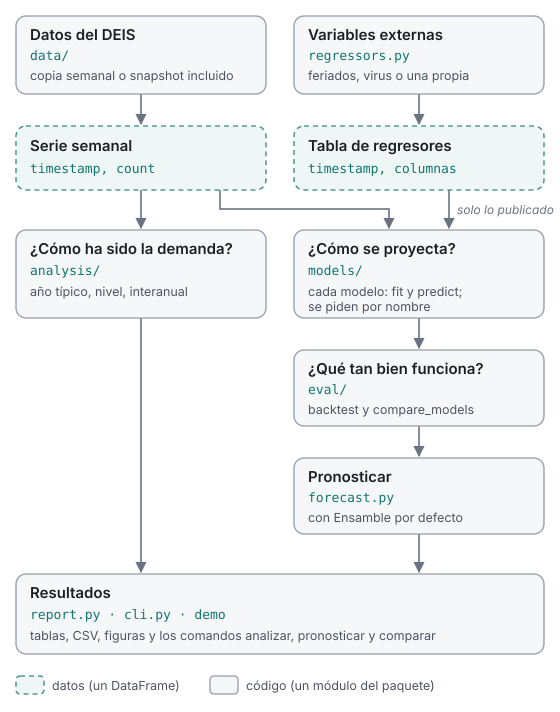

# Arquitectura

urg-forecast-core es una base para **analizar y proyectar las atenciones de urgencia** de
la red pública chilena con datos abiertos: series semanales por establecimiento, modelos
simples, evaluación honesta y ejemplos que se pueden copiar. Este documento explica cómo
está organizado el paquete y dónde va cada cosa nueva.

**Dentro del alcance:** atenciones agregadas (por establecimiento y semana) de fuentes
públicas, más variables externas agregadas (virus, calendario, clima).
**Fuera del alcance:** datos por paciente, simulación de flujo, dotación y cualquier
herramienta operacional validada. Esas cosas pueden construirse encima, en otro
repositorio.

## El recorrido de los datos

1. **Datos.** `data/` lee el DEIS (la copia semanal o el snapshot incluido) y
   `weekly_series` lo deja como serie semanal: `timestamp`, `count`.
2. **Análisis.** `analysis/` describe esa serie: año típico, nivel, comparación interanual.
3. **Modelos.** `models/` la proyecta. Cada modelo tiene `fit` y `predict`, y se piden por
   nombre. `HarmonicExogenous` suma una tabla de variables externas (`regressors.py`), usando
   en cada fecha solo lo que ya estaba publicado.
4. **Evaluación.** `eval/` mide cada modelo en el pasado (`backtest`) y dice si un cambio
   ayuda de verdad (`compare_models`).
5. **Pronóstico.** `forecast.py` elige el mejor según un criterio (por defecto, la pérdida
   P80; `select_by` usa otro) y pronostica.
6. **Resultados.** `report.py`, `cli.py` y la demo muestran el análisis y el pronóstico.

Todo es un `DataFrame` de pandas: no hay clases de datos propias ni base de datos.

## Un módulo por pregunta

| Pregunta | Dónde | Entrada → salida |
|---|---|---|
| ¿De dónde vienen las series? | `data/` (`deis.py`, `mirror.py`, `flunet.py`, `series.py`) | código DEIS → filas DEIS → `timestamp, count` |
| ¿Cómo ha sido la demanda? | `analysis/` (`descriptive.py`, `report.py`) | serie semanal → tablas: por año, año típico, nivel, interanual |
| ¿Cómo se proyecta? | `models/` (`protocol.py`, `baselines.py`, `harmonic.py`, `exogenous.py`, `ensemble.py`, `registry.py`) | historia → cuantiles futuros |
| ¿Qué tan bien funciona? | `eval/` (`backtest.py`, `metrics.py`, `calibration.py`, `compare.py`) | modelos + historia → error por ventana, veredicto |
| ¿Cuál uso y qué viene? | `forecast.py` | historia → `ForecastResult` |
| ¿Qué variables externas hay? | `regressors.py` (fuentes), `features/calendar.py` (calendario chileno) | → `Regressor`: tabla semanal + reglas de publicación |
| ¿Cómo se muestra? | `report.py`, `cli.py` | resultado → tablas, CSV, PNG; comandos en español |

Las funciones de uso común se importan directo: `from urgencias_core import load_deis,
weekly_series, run_forecast, backtest, compare_models, default_models`; las de análisis,
desde `urgencias_core.analysis`.

`experiments/model_comparison.py` es el estudio detrás de
[`seleccion-de-modelos.md`](seleccion-de-modelos.md); no es parte del paquete.

## Los contratos

Son pocos y cortos; respetarlos es lo que permite combinar piezas.

**Serie semanal.** Un `DataFrame` con `timestamp` (el lunes que cierra cada semana:
frecuencia `W-MON`, los 7 días que terminan ese lunes) y `count`. Solo semanas completas;
2020 y 2021 quedan fuera (pandemia). Lo produce `weekly_series` y lo consume todo lo demás.

**Modelo (`Forecaster`).** Una clase con:

- `fit(history, target_col)`: aprende de la serie semanal.
- `predict(horizon)`: devuelve `horizon.length` filas con `timestamp` y una columna por
  cuantil de `horizon.quantiles`, ordenadas de menor a mayor: `q50, q80, q90, q95` por
  defecto, y también `q5, q10, q20` cuando se elige por WIS. Las fechas salen de
  `models.protocol.future_index(ultima_semana, horizon)`.
- Un constructor sin argumentos obligatorios. Si el modelo tiene parámetros, se registra
  una función que lo construye (`lambda: Modelo(k=4)`).

**Regresor externo (`regressors.Regressor`).** Una tabla con `timestamp` (mismas semanas
DEIS) y una columna por variable, más las reglas de su fuente: cuántas semanas tarda en
publicarse (`report_delay_weeks`) y si su futuro se conoce (`known_future`: el calendario
sí, la vigilancia viral no). El modelo elige el rezago (`lag_weeks`) y cómo llenar lo no
publicado (`future`). Regla: **en cada ventana del backtest el modelo solo ve lo que estaba
publicado en esa fecha**. Lo implementa `models.exogenous.HarmonicExogenous`
(`from_regressor`).

**Evaluación.** `eval.backtest.backtest(historia, modelos, length, origins, step)` ajusta
cada modelo desde cero en ventanas que van hacia atrás desde el final; ninguna ventana ve
el futuro de otra. Devuelve las predicciones de cada ventana y `scores()`, una fila por
ventana y modelo. `run_forecast` y `compare_models` se construyen encima; no escribas otro
ciclo de backtest.

## Cómo agregar cada cosa

**Una fuente de datos.** Un módulo en `data/` con una función `load_...` que devuelva un
`DataFrame` (para un regresor: `timestamp` + columnas, ya en semanas DEIS). Si la fuente es
pública y pesada o lenta, agrega un paso en `scripts/construir_datos.py` que la copie a la
rama `datos` cada semana, sin bloquear el resto si falla, y su atribución en
`scripts/LEEME_datos.md`. Ejemplo completo: `data/flunet.py`.

**Un modelo.** La clase en `models/`, su función en `extra_models()` y su línea en
`MODEL_INFO` (`models/registry.py`), una sección en [`modelos.md`](modelos.md) y una prueba
que revise la forma de la salida. Antes de proponerlo como modelo por defecto, compáralo con
`urg-forecast comparar` en varios establecimientos. Ejemplo: `examples/03_modelo_propio.py`.

**Un regresor.** Una función en `regressors.py` que devuelva un `Regressor` (su tabla, sus
columnas, el atraso de publicación y si el futuro se conoce) y su nombre en
`available_regressors()`. Para probarlo: `HarmonicExogenous.from_regressor(regresor,
lag_weeks=, future=)` y `compare_models` contra el Armónico en varios establecimientos. Si
gana, se registra como modelo (como `ArmónicoCalendario`). Documenta el resultado aunque
sea negativo: también le sirve a quien venga después. Ejemplo:
`examples/04_regresor_externo.py`; la explicación completa, en [Regresores](regresores.md).

**Un análisis.** Una función en `analysis/descriptive.py` (o un módulo nuevo en
`analysis/` si es otro tema) que recibe la serie semanal y devuelve un `DataFrame`, sin
leer ni escribir archivos y sin graficar; el texto, la figura y los CSV van en
`analysis/report.py`. Que respete los huecos (2020–2021 no se rellenan) y no confunda
tendencia con estación: `seasonal_profile` compara cada semana con el nivel de su propio
año. Pruébala con una serie sintética de forma conocida (`tests/test_analysis.py`).
Ejemplo: `examples/05_analisis.py`.

**Un comando.** Un subcomando en `cli.py` con su ayuda y ejemplos en español, que llame a
funciones del paquete (la lógica no vive en la CLI), y una prueba en `tests/test_cli.py`.

**Una función pública.** Además de su docstring, una entrada en
`scripts/construir_api.py` (explicación, parámetros y un ejemplo que corra con el
snapshot), y `uv run python scripts/construir_api.py` para regenerar la página
[Para desarrolladores](https://nicoveraz.github.io/urg-forecast-core/desarrolladores/). La
CI ejecuta los ejemplos y avisa si una firma documentada cambió sin regenerarla.

**Un ejemplo.** `examples/NN_nombre.py` con `main(argv)` y una línea en
`tests/test_examples.py`; ver [`examples/README.md`](https://github.com/nicoveraz/urg-forecast-core/blob/main/examples/README.md).

## Reglas que valen para todo

- **Nada mira el futuro.** Ni modelos, ni regresores, ni calibración usan datos
  posteriores al origen de cada ventana.
- **Un resultado negativo también se documenta.**
- **Interfaz en español, código en inglés.** Mensajes, ayuda y documentos en español; nombres
  y docstrings en inglés. Los ejemplos usan nombres en español porque son para leerlos.
- **Dependencias mínimas.** Antes de sumar una biblioteca, abre un issue.
- **Sin datos de pacientes.** Solo agregados públicos; las pruebas usan datos sintéticos o el
  snapshot incluido.
- **Rutas estables.** Si algo cambia de lugar, la ruta antigua sigue funcionando con un aviso
  durante una versión (`_compat.py`).
